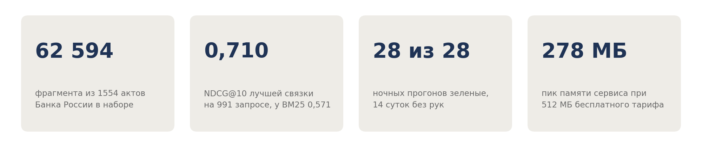
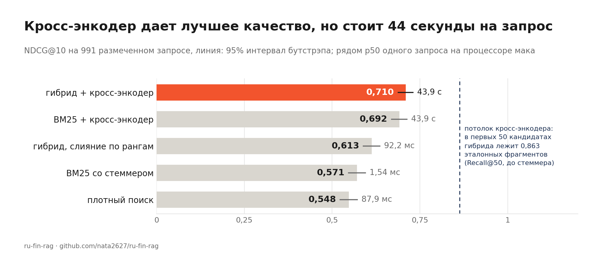
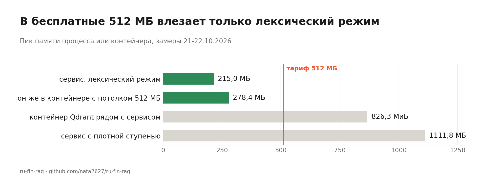
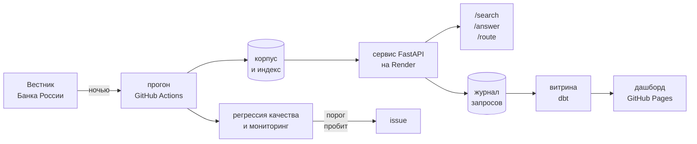
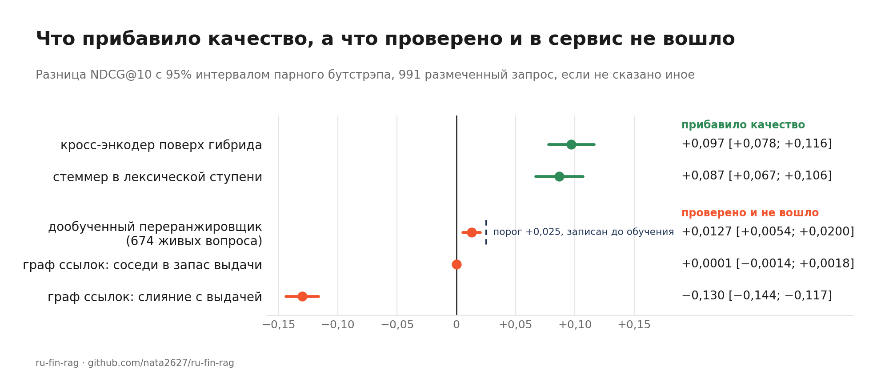
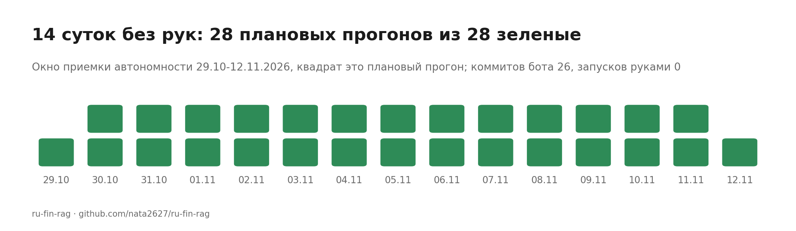

# ru-fin-rag

[](https://github.com/nata2627/ru-fin-rag/actions/workflows/check.yml)
[](https://github.com/nata2627/ru-fin-rag/actions/workflows/nightly.yml)

**[Живой сервис](https://ru-fin-rag.onrender.com)** · [запрос из браузера](https://ru-fin-rag.onrender.com/docs) · [дашборд журнала](https://nata2627.github.io/ru-fin-rag/) · [набор на HuggingFace](https://huggingface.co/datasets/nata2627/ru-fin-retrieval) · [переранжировщик на HuggingFace](https://huggingface.co/nata2627/ru-fin-reranker) · [исследование качества](retrieval/)

Сервис поиска и ответа по нормативным актам Банка России. На 22.11.2026 в корпусе 1555 акта и
62 606 фрагмента, новые акты докачивает ночной прогон. Сервис живет без моей машины, рук и
денег: API на бесплатном тарифе Render, расписание на GitHub Actions, дашборд на GitHub Pages.



Качество поиска измерено исследованием в папке [retrieval](retrieval/): 991 размеченный
запрос, шесть энкодеров и пять связок на одних данных, доверительные интервалы и
перестановочный тест. Каждое число этого файла и документов в [`docs/`](docs/) лежит в
[`results/`](results/), [`scripts/verify_numbers.py`](scripts/verify_numbers.py) пересчитывает
их при каждой проверке и роняет ее при расхождении.

## Что измерено



| Связка | Что делает | p50 | p95 | Качество, NDCG@10 на 991 |
|---|---|---:|---:|---:|
| `bm25` | лексический поиск по разреженной матрице | 1,54 мс | 2,68 мс | 0,571 |
| `dense` | плотный поиск по векторам на 384 измерения | 87,9 мс | 162,5 мс | 0,548 |
| `hybrid` | слияние обеих выдач обратными рангами | 92,2 мс | 202,6 мс | 0,613 |
| `bm25-rerank` | лексический поиск плюс кросс-энкодер | 43,9 с | 46,6 с | 0,692 |
| `hybrid-rerank` | гибрид плюс кросс-энкодер | 43,9 с | 44,6 с | 0,710 |

Задержка снята на маке M1 с 8 ГБ памяти, качество на 991 размеченном запросе.

- **Кросс-энкодер дает лучшее качество и в онлайн не идет.** Прибавка к гибриду
  +0,097 [0,078; 0,116], но на процессоре это 44 секунды на запрос, поэтому он остается
  конфигурацией и офлайн-замером.
- **На бесплатном тарифе работает `bm25`.** Модель запроса для плотной ступени стоит 1,1 ГБ
  против 512 МБ тарифа. Где плотная ступень есть, гибрид сильнее: 0,613 против 0,571.
- **По открытой ссылке запрос занимает полсекунды.** p50 470,6 мс и p95 669,3 мс, замер из
  Москвы до Франкфурта и обратно. После сна первый запрос ждет пробуждения контейнера.



Лексический режим влезает в 512 МБ с запасом, и это стоило работы: тексты фрагментов держатся
сжатыми блоками по 64, строками сервис занимал 527 МБ. Все таблицы (нагрузка, векторные
хранилища, репетиция тарифа, воспроизводимость выдачи) в [`docs/measurements.md`](docs/measurements.md).

## Как устроено



| Слой | Что делает | Подробно |
|---|---|---|
| Ядро поиска | BM25 со стеммером, плотная ступень, слияние RRF, кросс-энкодер, связка читается из `configs/retrieval.yaml` | [`measurements.md`](docs/measurements.md) |
| Журнал и витрина | каждый запрос пишется в журнал, витрину собирает dbt над ClickHouse, числа показывает статическая страница | [`logging.md`](docs/logging.md) |
| Регламент | ночной прогон докачивает акты, пересобирает индекс, считает регрессию и коммитит результат, тот же порядок описан DAG на Airflow | [`regulation.md`](docs/regulation.md) |
| Мониторинг | три сигнала в ночном шаге, при пробитии порога открывается issue | [`regulation.md`](docs/regulation.md) |
| Онлайн сравнение | правило размера выборки и остановки записано до данных, сравнение идет интерливингом | [`negative.md`](docs/negative.md) |
| Ответ | выдержки с цитатами на акт и пункт, отказ без опоры в корпусе | [`answer.md`](docs/answer.md) |
| Роутер и граф | выбор инструмента под запрос, расширение выдачи по ссылкам между актами | [`answer.md`](docs/answer.md) |

**Стек:** Python, FastAPI, numpy, scipy, sentence-transformers, FAISS, Qdrant, ClickHouse, dbt,
Airflow, Docker, locust, MLflow, GitHub Actions, GitHub Pages, Render.

## Таблица навыков

Слева навык, в середине файл, где он написан, справа число и файл, в котором оно посчитано.
Таблицу печатает [`scripts/skills_table.py`](scripts/skills_table.py) из файлов `results/`,
руками числа в нее не вносятся. Два числа меняет ночной прогон, он же вписывает таблицу
заново.

| Навык | Где в коде | Чем подтвержден | Где посчитано |
|---|---|---|---|
| Лексический поиск BM25 со снятием формы слова | [`bm25.py`](src/rufinrag/retrieval/bm25.py), [`text.py`](src/rufinrag/retrieval/text.py) | p50 1,54 мс, p95 2,68 мс на маке | [`latency-local.json`](results/latency-local.json) |
| Плотный поиск и гибрид через RRF | [`dense.py`](src/rufinrag/retrieval/dense.py), [`fusion.py`](src/rufinrag/retrieval/fusion.py) | гибрид p50 92,17 мс, p95 202,62 мс | [`latency-local.json`](results/latency-local.json) |
| Переранжирование кросс-энкодером | [`rerank.py`](src/rufinrag/retrieval/rerank.py) | прибавка NDCG@10 0,097 [0,0776; 0,116] | [`rerank-quality.json`](results/rerank-quality.json) |
| Выбор векторного хранилища по замеру | [`compare_vector_stores.py`](scripts/compare_vector_stores.py), [`dense.py`](src/rufinrag/retrieval/dense.py) | faiss p50 2,08 мс против numpy 3,13 мс, индекс 91,7 МБ | [`vector-store.json`](results/vector-store.json) |
| Квантование векторов: замер, в сервисе не применяется | [`measure_quantization.py`](scripts/measure_quantization.py) | память 22,9 МБ против 91,7 МБ, перекрытие топ-10 0,995 | [`quantization.json`](results/quantization.json) |
| Сервис на FastAPI на бесплатном хостинге | [`api.py`](src/rufinrag/api.py) | p50 470,6 мс, p95 669,3 мс по открытой ссылке | [`latency-hosted.json`](results/latency-hosted.json) |
| Журнал запросов и витрина на ClickHouse в двух режимах | [`warehouse.py`](src/rufinrag/warehouse.py), [`events.py`](src/rufinrag/events.py) | 253 строк журнала: 200 запросов и 53 отзывов, оба режима сошлись | [`warehouse.json`](results/warehouse.json) |
| Модели витрины на dbt | [`models/`](dbt/models/) | 8 моделей собираются за 3,8 с | [`dbt.json`](results/dbt.json) |
| Онлайн сравнение связок и перестановочный тест | [`interleaving.py`](src/rufinrag/interleaving.py), [`compare_configs.py`](scripts/compare_configs.py) | 0,6126 против 0,5711, разница 0,0414 | [`compare-configs.json`](results/compare-configs.json) |
| Правило размера выборки и остановки, записанное до данных | [`plan_sample_size.py`](scripts/plan_sample_size.py), [`interleaving.py`](src/rufinrag/interleaving.py) | альфа 0,05, мощность 0,80, целевой эффект 0,02 | [`sample-size.json`](results/sample-size.json) |
| Порог алерта по разбросу доливки и проверка деградацией | [`monitoring.py`](src/rufinrag/monitoring.py), [`measure_alert_threshold.py`](scripts/measure_alert_threshold.py) | порог 0,020 по 40 прогонам доливки, учебная деградация поймана на просадке 0,0216, самая большая незамеченная 0,0108 | [`alert-threshold.json`](results/alert-threshold.json), [`alert-drill.json`](results/alert-drill.json) |
| Регламент по расписанию без ее машины | [`nightly.yml`](.github/workflows/nightly.yml), [`dags/`](dags/) | 63 прогонов, следимая метрика 0,5712 | [`regulation.json`](results/regulation.json) |
| Ответ с цитатами и отказ без опоры | [`answer.py`](src/rufinrag/answer.py), [`generation.py`](src/rufinrag/generation.py) | ссылка на релевантный фрагмент 731 из 976, отказов 15 из 991 | [`answer-quality.json`](results/answer-quality.json) |
| Роутер на инструментах, отрицательный результат | [`router.py`](src/rufinrag/router.py) | маршруты: акты 892, граф 84, отказ 15; качество не изменилось | [`router.json`](results/router.json) |
| Граф ссылок между актами, отрицательный результат | [`graph.py`](src/rufinrag/graph.py) | 4376 дуг, ссылки внутрь у 1173 актов из 1555, прибавки нет | [`graph-expansion.json`](results/graph-expansion.json) |
| Воспроизводимость выдачи от прогона к прогону | [`check_reproducibility.py`](scripts/check_reproducibility.py) | состав топ-10 совпал у 199 из 200 запросов | [`reproducibility.json`](results/reproducibility.json) |
| Приемка автономности по факту, а не по обещанию | [`record_acceptance.py`](scripts/record_acceptance.py) | прогонов 63, зеленых 60, нужно 14 дней | [`acceptance.json`](results/acceptance.json) |

Чего проект не закрывает (временные ряды, A/B на пользователях, распределенная обработка,
рекомендательные системы) и почему, сказано в [`docs/limitations.md`](docs/limitations.md).

## Что проверено и не вошло



- **Дообученный переранжировщик.** На живом тесте из 674 вопросов прибавка
  +0,0127 [+0,0054; +0,0200] NDCG@10: она установлена, но меньше порога +0,025, записанного
  до обучения, поэтому в сервис модель не вошла.
- **Роутер на инструментах** работает и качества не прибавляет.
- **Расширение выдачи по графу ссылок** между актами: 4376 дуг, прибавки нет.
- **Онлайн сравнение на живом трафике не проведено**, у сервиса нет пользователей. По
  правилу, записанному до данных, оно заменено офлайн интерливингом: 0,6126 против 0,5711.
- **Не снят один замер:** квантованная модель на внешней видеокарте. Ответ от этого не
  зависит, выдержки с цитатами работают без ключа модели.

Разбор каждого результата и семь поломок с причинами в [`docs/negative.md`](docs/negative.md).

## Обновляется сам



Ночной прогон на GitHub Actions докачивает новые акты, пересобирает индекс, проверяет
качество и коммитит результат. За 14 суток подряд, с 29.10.2026 по 12.11.2026, прошло 28
плановых прогонов из 28, руками не запускался ни один, постоянных расходов нет. Как это
считается и на чем расписание может остановиться, в [`docs/regulation.md`](docs/regulation.md).

## Ограничения

- Корпус это «Вестник Банка России», то есть акт в редакции на дату принятия. Действующих
  редакций в нем нет.
- Из 991 размеченного запроса 846 написала модель (85%), 142 это настоящие вопросы поднадзорных
  организаций, 3 написаны руками. Живой тест из 1 002 вопросов размечен моделью и сверен
  человеком на 200 парах.
- Отказ отвечает на вопрос «есть ли опора в корпусе». Вопрос из соседней отрасли права сервис
  не отклонит, и набора таких вопросов в проекте нет.
- Задержки сняты на одной машине, числа хостинга сняты отдельно, между собой они не
  сравниваются.
- Бесплатный тариф засыпает через 15 минут без трафика. Сервис будит внешний монитор, без
  него первый запрос ждет пробуждения.

Полный список в [`docs/limitations.md`](docs/limitations.md).

## Документация

| Документ | О чем |
|---|---|
| [`measurements.md`](docs/measurements.md) | Задержка, качество связок, память, нагрузка, хостинг, векторные хранилища, воспроизводимость |
| [`logging.md`](docs/logging.md) | Журнал запросов, витрина на dbt, поток логов в репозиторий, дашборд |
| [`regulation.md`](docs/regulation.md) | Ночной прогон, DAG на Airflow, мониторинг, реестр версий, приемка автономности |
| [`answer.md`](docs/answer.md) | Ответ с цитатами, отказ без опоры, качество ссылок, роутер, граф ссылок |
| [`negative.md`](docs/negative.md) | Онлайн сравнение, дообученный переранжировщик, что не сработало |
| [`limitations.md`](docs/limitations.md) | Ограничения метода и автономности, чего проект не закрывает |
| [`running.md`](docs/running.md) | Запуск с плотной ступенью, проверка, раскладка репозитория |
| [`experiments.md`](docs/experiments.md) | Гипотезы и правила, записанные до чисел |
| [`retrieval/`](retrieval/) | Исследование качества поиска: набор, энкодеры, связки, дообучение |

## Как поднять

Нужен python 3.11 или 3.12 и около 250 МБ свободной памяти. Корпус лежит в репозитории
сжатым, скачивать ничего не надо.

```
make venv                                 # окружение и зависимости
source .venv/bin/activate
python scripts/build_index.py             # индекс BM25 и блоки текстов
make serve                                # сервис на http://127.0.0.1:8000
curl -s -X POST http://127.0.0.1:8000/search \
  -H 'Content-Type: application/json' \
  -d '{"query": "требования к расчету норматива достаточности капитала"}'
```

`make check` гоняет линтер, тесты, пересчет чисел и поиск секретов. Плотная ступень и
остальное в [`docs/running.md`](docs/running.md).
