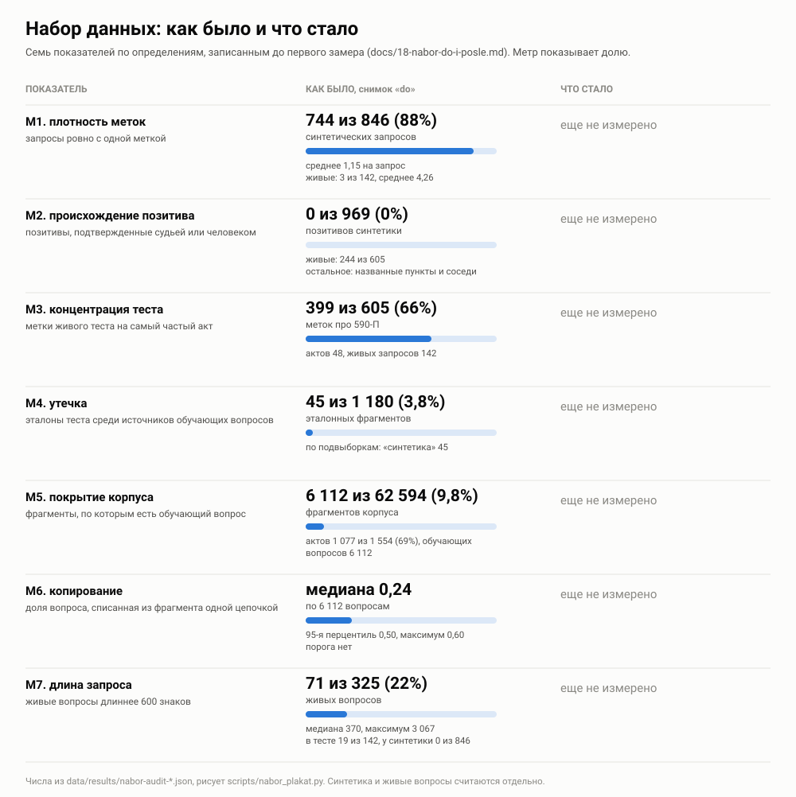

# Набор данных: как было и что стало

Этап 11 правит только набор: метки, сплит, подвыборки. Обучение на этом этапе не трогается.
Чтобы улучшение нельзя было нарисовать задним числом, семь показателей определены до первого
замера (раздел «Определения» ниже), снимок «как было»
снят 29.10.2026 до любой правки данных, а снимок «что стало» снимет тот же скрипт по тем же
определениям. Показатель, который не сдвинется, останется на плакате как есть.

Числа в `data/results/nabor-audit-do.json`. Пересчитываются так:

```
python3 scripts/nabor_audit.py --tag do
python3 scripts/nabor_plakat.py --do data/results/nabor-audit-do.json
```

Плакат и таблица ниже рисуются вторым скриптом из снимка, руками в них ничего не вписывается.
Сходимость держит `tests/test_plakat_nabora.py`: плакат совпадает с тем, что скрипт рисует
из снимка, каждое число плаката и таблицы есть в снимке, а снимок заново считается из данных.



<!-- tablica: nabor_plakat.py -->
| Показатель | Что считается | Как было | Подробности | Что стало |
|---|---|---|---|---|
| M1 плотность меток | запросы ровно с одной меткой | 744 из 846 (88%) синтетических запросов | среднее 1,15 на запрос; живые: 3 из 142, среднее 4,26 | еще не измерено |
| M2 происхождение позитива | позитивы, подтвержденные судьей или человеком | 0 из 969 (0%) позитивов синтетики | живые: 244 из 605; остальное: названные пункты и соседи | еще не измерено |
| M3 концентрация теста | метки живого теста на самый частый акт | 399 из 605 (66%) меток про 590-П | актов 48, живых запросов 142 | еще не измерено |
| M4 утечка | эталоны теста среди источников обучающих вопросов | 45 из 1 180 (3,8%) эталонных фрагментов | по подвыборкам: «синтетика» 45 | еще не измерено |
| M5 покрытие корпуса | фрагменты, по которым есть обучающий вопрос | 6 112 из 62 594 (9,8%) фрагментов корпуса | актов 1 077 из 1 554 (69%), обучающих вопросов 6 112 | еще не измерено |
| M6 копирование | доля вопроса, списанная из фрагмента одной цепочкой | медиана 0,24 по 6 112 вопросам | 95-я перцентиль 0,50, максимум 0,60; порога нет | еще не измерено |
| M7 длина запроса | живые вопросы длиннее 600 знаков | 71 из 325 (22%) живых вопросов | медиана 370, максимум 3 067; в тесте 19 из 142, у синтетики 0 из 846 | еще не измерено |
<!-- /tablica -->

## Определения

Записаны 29.10.2026 до первого замера. Плакат «что стало» считает ровно их, тем же скриптом.

| № | Показатель | Как считается |
|---|---|---|
| M1 | плотность меток | метки на размеченный запрос, среднее и медиана, и доля запросов ровно с одной меткой, по `data/queries/qrels.tsv` отдельно по подвыборкам |
| M2 | происхождение позитива | доля позитивов, подтвержденных разметкой (судья или человек), против доли позитивов, взятых из происхождения вопроса (фрагмент-источник генерации) |
| M3 | концентрация теста | доля меток самого частого акта, число актов, число запросов в живом тесте |
| M4 | утечка | число и доля фрагментов, которые одновременно эталон теста и источник обучающего вопроса |
| M5 | покрытие корпуса | доля фрагментов и доля актов, по которым есть хотя бы один обучающий вопрос |
| M6 | копирование | медиана и 95-я перцентиль `copy_share` обучающей выборки, доля вопросов выше порога этапа |
| M7 | длина запроса | медиана, 95-я перцентиль, максимум и доля запросов длиннее 600 знаков, отдельно по живым и синтетике |

Правила замера. Оба снимка считает один скрипт и оба лежат файлами, плакат читает их, а не
текст. Знаменатель печатается рядом с каждой долей. Показатель, который не улучшился,
печатается как есть, объяснение ставится рядом, а определение не меняется. Живые и
синтетика считаются отдельно. Если показатель после правок перестает быть вычислимым, это
говорится прямо, а старое число остается в снимке «до».

## Что показывает каждый блок

**M1, плотность меток.** Синтетический вопрос писался моделью по одному фрагменту, и почти
всегда этот фрагмент и есть вся разметка. Метрика тогда считает промахом любой другой
фрагмент, где ответ тоже есть. У живых вопросов картина другая: меток на запрос в несколько
раз больше, потому что их дали названные Банком России пункты и судья по пулу. Общая цифра
по всем запросам из первого определения M1 смешивает эти две картины и поэтому на плакат не вынесена,
она лежит в снимке рядом с подвыборками.

**M2, происхождение позитива.** Позитив синтетики взят из того, по какому фрагменту вопрос
сгенерирован, и ни один такой позитив не проверен ни судьей, ни человеком. У живых вопросов
подтвержденные разметкой метки составляют меньше половины, остальное это пункты, которые
назвал сам Банк России, и соседние фрагменты, физически перекрывающие эталон.

**M3, концентрация теста.** Две трети меток живого теста про одно положение 590-П. Число на
живых вопросах поэтому во многом число про один акт.

**M4, утечка.** Фрагмент, который одновременно эталон в тесте и источник обучающего вопроса.
Все пересечения лежат в подвыборке «синтетика», у живых вопросов их нет. Значит утечка
могла завышать прибавку дообучения на синтетике и не задевала ворота по живым вопросам.

**M5, покрытие корпуса.** Обучающие вопросы написаны по десятой части фрагментов. По актам
покрытие выше, но почти треть актов модель при обучении не видела вовсе.

**M6, копирование.** `copy_share` это длина самой длинной общей цепочки слов вопроса и
фрагмента, деленная на длину вопроса. Порога у нее нет, поэтому строка «выше порога» в снимке
пустая: доли без порога не бывает, и придумывать порог задним числом значит подогнать
показатель.

**M7, длина запроса.** Пятая часть живых вопросов длиннее 600 знаков: это письма с
предысторией, а не поисковые запросы. Синтетических вопросов такой длины нет ни одного.

Дефекты M5 и M6 относятся к обучающей выборке. На этом этапе они только измеряются: менять
генерацию без решения по подходу к обучению незачем.

## Задача 11.1: пункт вместо куска

Эталон «ответ во фрагменте `#0005`» зависит от нарезки. Разбор провалов
(`docs/16-razbor-provalov.md`) нашел два механизма, где из-за этого метрика пишет промах при
правильном ответе. Банк России называет пункт 3.12, эталоном стоит фрагмент, где 3.12
начинается, а поиск приносит фрагмент с подпунктом 3.12.2.8. Длинный пункт режется на куски,
эталоном стоит один кусок, соседний кусок того же пункта считается промахом.

Поэтому метки переведены на пункты (`data/queries/qrels_punkt.tsv`, устройство в
`src/rufin/punkt.py`). Названный Банком России пункт засчитывается фрагментом, где начинается
он сам или его подпункт (подпункты в приложениях не считаются, там своя нумерация), и куском
его продолжения. Метка на фрагменте, который оказался куском длинного пункта, переходит на все
куски этого пункта. Прочие метки остаются на своих фрагментах. Прежние метки не удаляются:
скрипт падает, если хоть один прежний позитив не попал ни в одну единицу.

Выдача поиска остается списком фрагментов и разворачивается в список пунктов. Фрагмент
заменяется пунктами эталона, которые он приносит впервые, фрагмент без пунктов эталона
занимает одну позицию как промах, повтор уже найденного пункта позиции не занимает. Если
каждая метка стоит на своем фрагменте и кусков нет, числа совпадают с прежними, это держит
`tests/test_punkt.py`.

**Правило счета поменялось один раз, после первого прогона, и это надо знать.** В первой
версии фрагмент с двумя названными пунктами давал вклад одного, а идеальная выдача
рассчитывалась с двумя позициями. Безупречная выдача на вопросе `exp0008` получала 0,765
вместо единицы, и у пяти дообученных связок NDCG@10 на живых падал. Ошибка в устройстве
счета, а не в данных, на нее теперь стоит тест (идеальная выдача дает ровно единицу). Числа
ниже посчитаны исправленным правилом, первая версия нигде не опубликована.

Пересчет на тех же сохраненных выдачах, новых прогонов поиска нет:

```
python3 scripts/punkt_effect.py
```

<!-- tablica: punkt_effect.py -->
| Связка | Подвыборка | Запросов | NDCG@10 по фрагментам | NDCG@10 по пунктам | Разница [95%] |
|---|---|---|---|---|---|
| bm25 | живые | 142 | 0,350 | 0,398 | +0,047 [+0,031; +0,066] |
| bm25 | заголовочная | 541 | 0,536 | 0,558 | +0,022 [+0,015; +0,030] |
| bm25 | синтетика | 150 | 0,578 | 0,593 | +0,015 [+0,004; +0,028] |
| dense-user-bge-m3 | живые | 142 | 0,357 | 0,385 | +0,028 [+0,015; +0,043] |
| dense-user-bge-m3 | заголовочная | 541 | 0,479 | 0,498 | +0,019 [+0,012; +0,026] |
| dense-user-bge-m3 | синтетика | 150 | 0,510 | 0,521 | +0,011 [+0,002; +0,022] |
| hybrid | живые | 142 | 0,401 | 0,443 | +0,042 [+0,026; +0,059] |
| hybrid | заголовочная | 541 | 0,577 | 0,597 | +0,019 [+0,013; +0,026] |
| hybrid | синтетика | 150 | 0,598 | 0,615 | +0,017 [+0,004; +0,035] |
| hybrid-rerank | живые | 142 | 0,459 | 0,516 | +0,057 [+0,039; +0,078] |
| hybrid-rerank | заголовочная | 541 | 0,683 | 0,705 | +0,022 [+0,015; +0,029] |
| hybrid-rerank | синтетика | 150 | 0,730 | 0,745 | +0,015 [+0,004; +0,029] |

Строк «связка и подвыборка», где NDCG@10 упал и интервал не накрывает ноль: 0 из 175. Провалов hybrid-rerank на живых (ни одного позитива в первой десятке): 27 по фрагментам, 22 по пунктам. Из 4 провалов метрики разбора исчезли 4.
<!-- /tablica punkt -->

Полная таблица по всем 25 связкам и семи подвыборкам лежит в `data/results/punkt-effect.json`
и `docs/raw/punkt_effect.txt`. Смысл прибавки: качество поиска не менялось, менялась линейка.
Часть прежних промахов на живых вопросах была промахом нарезки, и на синтетике тоже: там
прибавку дает склейка кусков длинного пункта.

## Задача 11.2: утечка по фрагментам

Утечка здесь это фрагмент, который одновременно лежит в эталоне теста и служит источником
обучающего вопроса. Эталон теста считается в единицах «пункт» из задачи 11.1: если эталоном
стал длинный пункт, все его куски эталон. Поэтому в единицах «пункт» утечка больше, чем в
снимке «как было», где она считалась по одному фрагменту.

Почему прежняя проверка ее не видела. Сплит режется по актам, и проверка сплита смотрела,
не лежит ли эталон живого или ручного вопроса в обучающем акте. Подвыборка «синтетика»
собрана до сплита, большая часть ее запросов про обучающие акты, и в проверку она не
входила. Теперь `scripts/check_train_data.py` проверяет пересечение по фрагментам для всех
подвыборок, а тест падает на подложенном пересечении (`tests/test_split.py`).

Убирается обучающий вопрос, тест не трогается. Прежние обучающие файлы не переписываются: по
ним посчитаны опубликованные прогоны дообучения, и эти числа должны воспроизводиться. Чистая
выборка лежит рядом отдельным файлом, а утечка в остальных файлах посчитана, чтобы было видно,
что придется чистить, когда дойдет до нового обучения.

```
python3 scripts/drop_leak.py
```

<!-- tablica: drop_leak.py -->
Из `data/queries/synthetic_train.jsonl` убраны вопросы, написанные по фрагментам эталона теста, 71 из 6 112, осталось 6 041 (`data/queries/synthetic_train_noleak.jsonl`). Фрагментов утечки 71 из 1 678 фрагментов эталона теста. Запросов теста, чей эталон задет утечкой: «синтетика» 49.

| Прежний обучающий файл (не менялся) | Записей | С утечкой |
|---|---|---|
| `synthetic_train_e4.jsonl` | 6 270 | 82 |
| `synthetic_train_e4_filtered.jsonl` | 6 159 | 75 |
| `synthetic_train_e5.jsonl` | 6 490 | 156 |
| `synthetic_train_e5_filtered.jsonl` | 5 182 | 106 |
| `pairs_e5.jsonl` | 13 257 | 280 |

Негативов подготовки D0 (`train_prepared.jsonl`), лежащих в эталоне теста: 1 364 из 177 248.
<!-- /tablica utechka -->

**Какие прежние числа это затрагивает.** Все задетые запросы лежат в подвыборке «синтетика».
Значит затронуты числа дообучения, в которые она входит: столбец «все, 991» в таблицах
`docs/07-obuchenie.md` и прибавка дообучения по всем размеченным запросам, на которой
стоит формулировка «дообучение добавляет там, где вопрос писала модель». Заголовочная
подвыборка, dev и живые вопросы утечкой не задеты, поэтому решения ворот по живым вопросам
она не меняет. Пересчет прежних чисел в эту задачу не входит.

Отдельная находка обратного знака. Среди негативов подготовки D0 есть фрагменты эталона
теста: модель учили отталкивать фрагменты, которые для тестовых вопросов правильные. Такая
утечка не завышает, а может занижать числа дообученных моделей. Ее размер в блоке выше.
Обучение на этом этапе не трогается, поэтому она только записана.
