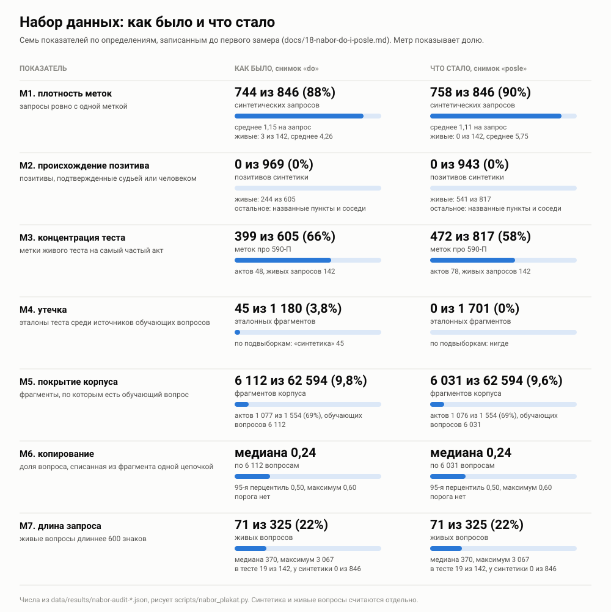

# Набор данных: как было и что стало

Этап 11 правит только набор: метки, сплит, подвыборки. Обучение на этом этапе не трогается.
Чтобы улучшение нельзя было нарисовать задним числом, семь показателей определены до первого
замера (раздел «Определения» ниже), снимок «как было»
снят 29.10.2026 до любой правки данных, а снимок «что стало» снял тот же скрипт по тем же
определениям после задачи 11.6. Показатель, который не сдвинулся, остался на плакате как есть,
почему, сказано в разделе «Итог этапа».

Числа в `data/results/nabor-audit-do.json` и `data/results/nabor-audit-posle.json`. Пересчитываются так:

```
python3 scripts/nabor_audit.py --tag do
python3 scripts/nabor_audit.py --tag posle --qrels data/queries/qrels_punkt.tsv \
    --train data/queries/synthetic_train_noleak.jsonl --subsets data/queries/podvyborki.json \
    --live-qrels data/queries/qrels_live_core.tsv --extra-judge data/queries/razmetka_yadro.tsv
python3 scripts/nabor_plakat.py --do data/results/nabor-audit-do.json \
    --posle data/results/nabor-audit-posle.json --out docs/img/nabor-do-i-posle.svg
```

Плакат «как было» без второго столбца остался рядом, `docs/img/nabor-do.svg`.

Плакат и таблица ниже рисуются вторым скриптом из снимка, руками в них ничего не вписывается.
Сходимость держит `tests/test_plakat_nabora.py`: плакат совпадает с тем, что скрипт рисует
из снимка, каждое число плаката и таблицы есть в снимке, а снимок заново считается из данных.



<!-- tablica: nabor_plakat.py -->
| Показатель | Что считается | Как было | Подробности | Что стало |
|---|---|---|---|---|
| M1 плотность меток | запросы ровно с одной меткой | 744 из 846 (88%) синтетических запросов | среднее 1,15 на запрос; живые: 3 из 142, среднее 4,26 | 758 из 846 (90%) синтетических запросов; среднее 1,11 на запрос; живые: 0 из 142, среднее 5,75 |
| M2 происхождение позитива | позитивы, подтвержденные судьей или человеком | 0 из 969 (0%) позитивов синтетики | живые: 244 из 605; остальное: названные пункты и соседи | 0 из 943 (0%) позитивов синтетики; живые: 541 из 817; остальное: названные пункты и соседи |
| M3 концентрация теста | метки живого теста на самый частый акт | 399 из 605 (66%) меток про 590-П | актов 48, живых запросов 142 | 472 из 817 (58%) меток про 590-П; актов 78, живых запросов 142 |
| M4 утечка | эталоны теста среди источников обучающих вопросов | 45 из 1 180 (3,8%) эталонных фрагментов | по подвыборкам: «синтетика» 45 | 0 из 1 701 (0%) эталонных фрагментов; по подвыборкам: нигде |
| M5 покрытие корпуса | фрагменты, по которым есть обучающий вопрос | 6 112 из 62 594 (9,8%) фрагментов корпуса | актов 1 077 из 1 554 (69%), обучающих вопросов 6 112 | 6 031 из 62 594 (9,6%) фрагментов корпуса; актов 1 076 из 1 554 (69%), обучающих вопросов 6 031 |
| M6 копирование | доля вопроса, списанная из фрагмента одной цепочкой | медиана 0,24 по 6 112 вопросам | 95-я перцентиль 0,50, максимум 0,60; порога нет | медиана 0,24 по 6 031 вопросам; 95-я перцентиль 0,50, максимум 0,60; порога нет |
| M7 длина запроса | живые вопросы длиннее 600 знаков | 71 из 325 (22%) живых вопросов | медиана 370, максимум 3 067; в тесте 19 из 142, у синтетики 0 из 846 | 71 из 325 (22%) живых вопросов; медиана 370, максимум 3 067; в тесте 19 из 142, у синтетики 0 из 846 |
<!-- /tablica -->

## Определения

Записаны 29.10.2026 до первого замера. Плакат «что стало» считает ровно их, тем же скриптом.

| № | Показатель | Как считается |
|---|---|---|
| M1 | плотность меток | метки на размеченный запрос, среднее и медиана, и доля запросов ровно с одной меткой, по `data/queries/qrels.tsv` отдельно по подвыборкам |
| M2 | происхождение позитива | доля позитивов, подтвержденных разметкой (судья или человек), против доли позитивов, взятых из происхождения вопроса (фрагмент-источник генерации) |
| M3 | концентрация теста | доля меток самого частого акта, число актов, число запросов в живом тесте |
| M4 | утечка | число и доля фрагментов, которые одновременно эталон теста и источник обучающего вопроса |
| M5 | покрытие корпуса | доля фрагментов и доля актов, по которым есть хотя бы один обучающий вопрос |
| M6 | копирование | медиана и 95-я перцентиль `copy_share` обучающей выборки, доля вопросов выше порога этапа |
| M7 | длина запроса | медиана, 95-я перцентиль, максимум и доля запросов длиннее 600 знаков, отдельно по живым и синтетике |

Правила замера. Оба снимка считает один скрипт и оба лежат файлами, плакат читает их, а не
текст. Знаменатель печатается рядом с каждой долей. Показатель, который не улучшился,
печатается как есть, объяснение ставится рядом, а определение не меняется. Живые и
синтетика считаются отдельно. Если показатель после правок перестает быть вычислимым, это
говорится прямо, а старое число остается в снимке «до».

## Что показывает каждый блок

**M1, плотность меток.** Синтетический вопрос писался моделью по одному фрагменту, и почти
всегда этот фрагмент и есть вся разметка. Метрика тогда считает промахом любой другой
фрагмент, где ответ тоже есть. У живых вопросов картина другая: меток на запрос в несколько
раз больше, потому что их дали названные Банком России пункты и судья по пулу. Общая цифра
по всем запросам из первого определения M1 смешивает эти две картины и поэтому на плакат не вынесена,
она лежит в снимке рядом с подвыборками.

**M2, происхождение позитива.** Позитив синтетики взят из того, по какому фрагменту вопрос
сгенерирован, и ни один такой позитив не проверен ни судьей, ни человеком. У живых вопросов
подтвержденные разметкой метки составляют меньше половины, остальное это пункты, которые
назвал сам Банк России, и соседние фрагменты, физически перекрывающие эталон.

**M3, концентрация теста.** Две трети меток живого теста про одно положение 590-П. Число на
живых вопросах поэтому во многом число про один акт.

**M4, утечка.** Фрагмент, который одновременно эталон в тесте и источник обучающего вопроса.
Все пересечения лежат в подвыборке «синтетика», у живых вопросов их нет. Значит утечка
могла завышать прибавку дообучения на синтетике и не задевала ворота по живым вопросам.

**M5, покрытие корпуса.** Обучающие вопросы написаны по десятой части фрагментов. По актам
покрытие выше, но почти треть актов модель при обучении не видела вовсе.

**M6, копирование.** `copy_share` это длина самой длинной общей цепочки слов вопроса и
фрагмента, деленная на длину вопроса. Порога у нее нет, поэтому строка «выше порога» в снимке
пустая: доли без порога не бывает, и придумывать порог задним числом значит подогнать
показатель.

**M7, длина запроса.** Пятая часть живых вопросов длиннее 600 знаков: это письма с
предысторией, а не поисковые запросы. Синтетических вопросов такой длины нет ни одного.

Дефекты M5 и M6 относятся к обучающей выборке. На этом этапе они только измеряются: менять
генерацию без решения по подходу к обучению незачем.

## Задача 11.1: пункт вместо куска

Эталон «ответ во фрагменте `#0005`» зависит от нарезки. Разбор провалов
(`docs/16-razbor-provalov.md`) нашел два механизма, где из-за этого метрика пишет промах при
правильном ответе. Банк России называет пункт 3.12, эталоном стоит фрагмент, где 3.12
начинается, а поиск приносит фрагмент с подпунктом 3.12.2.8. Длинный пункт режется на куски,
эталоном стоит один кусок, соседний кусок того же пункта считается промахом.

Поэтому метки переведены на пункты (`data/queries/qrels_punkt.tsv`, устройство в
`src/rufin/punkt.py`). Названный Банком России пункт засчитывается фрагментом, где начинается
он сам или его подпункт (подпункты в приложениях не считаются, там своя нумерация), и куском
его продолжения. Метка на фрагменте, который оказался куском длинного пункта, переходит на все
куски этого пункта. Прочие метки остаются на своих фрагментах. Прежние метки не удаляются:
скрипт падает, если хоть один прежний позитив не попал ни в одну единицу.

Выдача поиска остается списком фрагментов и разворачивается в список пунктов. Фрагмент
заменяется пунктами эталона, которые он приносит впервые, фрагмент без пунктов эталона
занимает одну позицию как промах, повтор уже найденного пункта позиции не занимает. Если
каждая метка стоит на своем фрагменте и кусков нет, числа совпадают с прежними, это держит
`tests/test_punkt.py`.

**Правило счета поменялось один раз, после первого прогона, и это надо знать.** В первой
версии фрагмент с двумя названными пунктами давал вклад одного, а идеальная выдача
рассчитывалась с двумя позициями. Безупречная выдача на вопросе `exp0008` получала 0,765
вместо единицы, и у пяти дообученных связок NDCG@10 на живых падал. Ошибка в устройстве
счета, а не в данных, на нее теперь стоит тест (идеальная выдача дает ровно единицу). Числа
ниже посчитаны исправленным правилом, первая версия нигде не опубликована.

Пересчет на тех же сохраненных выдачах, новых прогонов поиска нет:

```
python3 scripts/punkt_effect.py
```

<!-- tablica: punkt_effect.py -->
| Связка | Подвыборка | Запросов | NDCG@10 по фрагментам | NDCG@10 по пунктам | Разница [95%] |
|---|---|---|---|---|---|
| bm25 | живые | 142 | 0,350 | 0,398 | +0,047 [+0,031; +0,066] |
| bm25 | заголовочная | 541 | 0,536 | 0,558 | +0,022 [+0,015; +0,030] |
| bm25 | синтетика | 150 | 0,578 | 0,593 | +0,015 [+0,004; +0,028] |
| dense-user-bge-m3 | живые | 142 | 0,357 | 0,385 | +0,028 [+0,015; +0,043] |
| dense-user-bge-m3 | заголовочная | 541 | 0,479 | 0,498 | +0,019 [+0,012; +0,026] |
| dense-user-bge-m3 | синтетика | 150 | 0,510 | 0,521 | +0,011 [+0,002; +0,022] |
| hybrid | живые | 142 | 0,401 | 0,443 | +0,042 [+0,026; +0,059] |
| hybrid | заголовочная | 541 | 0,577 | 0,597 | +0,019 [+0,013; +0,026] |
| hybrid | синтетика | 150 | 0,598 | 0,615 | +0,017 [+0,004; +0,035] |
| hybrid-rerank | живые | 142 | 0,459 | 0,516 | +0,057 [+0,039; +0,078] |
| hybrid-rerank | заголовочная | 541 | 0,683 | 0,705 | +0,022 [+0,015; +0,029] |
| hybrid-rerank | синтетика | 150 | 0,730 | 0,745 | +0,015 [+0,004; +0,029] |

Строк «связка и подвыборка», где NDCG@10 упал и интервал не накрывает ноль: 0 из 225. Провалов hybrid-rerank на живых (ни одного позитива в первой десятке): 27 по фрагментам, 22 по пунктам. Из 4 провалов метрики разбора исчезли 4.
<!-- /tablica punkt -->

Полная таблица по всем 25 связкам и семи подвыборкам лежит в `data/results/punkt-effect.json`
и `docs/raw/punkt_effect.txt`. Смысл прибавки: качество поиска не менялось, менялась линейка.
Часть прежних промахов на живых вопросах была промахом нарезки, и на синтетике тоже: там
прибавку дает склейка кусков длинного пункта.

## Задача 11.2: утечка по фрагментам

Утечка здесь это фрагмент, который одновременно лежит в эталоне теста и служит источником
обучающего вопроса. Эталон теста считается в единицах «пункт» из задачи 11.1: если эталоном
стал длинный пункт, все его куски эталон. Поэтому в единицах «пункт» утечка больше, чем в
снимке «как было», где она считалась по одному фрагменту.

Почему прежняя проверка ее не видела. Сплит режется по актам, и проверка сплита смотрела,
не лежит ли эталон живого или ручного вопроса в обучающем акте. Подвыборка «синтетика»
собрана до сплита, большая часть ее запросов про обучающие акты, и в проверку она не
входила. Теперь `scripts/check_train_data.py` проверяет пересечение по фрагментам для всех
подвыборок, а тест падает на подложенном пересечении (`tests/test_split.py`).

Убирается обучающий вопрос, тест не трогается. Прежние обучающие файлы не переписываются: по
ним посчитаны опубликованные прогоны дообучения, и эти числа должны воспроизводиться. Чистая
выборка лежит рядом отдельным файлом, а утечка в остальных файлах посчитана, чтобы было видно,
что придется чистить, когда дойдет до нового обучения.

```
python3 scripts/drop_leak.py
```

<!-- tablica: drop_leak.py -->
Из `data/queries/synthetic_train.jsonl` убраны вопросы, написанные по фрагментам эталона теста, 81 из 6 112, осталось 6 031 (`data/queries/synthetic_train_noleak.jsonl`). Фрагментов утечки 81 из 1 819 фрагментов эталона теста. Запросов теста, чей эталон задет утечкой: «живые» 9, «синтетика» 49.

| Прежний обучающий файл (не менялся) | Записей | С утечкой |
|---|---|---|
| `synthetic_train_e4.jsonl` | 6 270 | 96 |
| `synthetic_train_e4_filtered.jsonl` | 6 159 | 89 |
| `synthetic_train_e5.jsonl` | 6 490 | 186 |
| `synthetic_train_e5_filtered.jsonl` | 5 182 | 132 |
| `pairs_e5.jsonl` | 13 257 | 333 |

Негативов подготовки D0 (`train_prepared.jsonl`), лежащих в эталоне теста: 1 528 из 177 248.
<!-- /tablica utechka -->

**Утечка после уплотнения живого теста (задача 11.5).** Новые позитивы живого теста попали на
10 фрагментов, по которым написаны обучающие вопросы. По тому же правилу эти вопросы тоже убраны
из обучения, тест не тронут, поэтому числа в блоке выше уже включают живой тест.

**Какие прежние числа это затрагивает.** До уплотнения все задетые запросы лежали в подвыборке «синтетика».
Значит затронуты числа дообучения, в которые она входит: столбец «все, 991» в таблицах
`docs/07-obuchenie.md` и прибавка дообучения по всем размеченным запросам, на которой
стоит формулировка «дообучение добавляет там, где вопрос писала модель». Заголовочная
подвыборка, dev и живые вопросы утечкой не задеты, поэтому решения ворот по живым вопросам
она не меняет. Пересчет прежних чисел в эту задачу не входит.

Отдельная находка обратного знака. Среди негативов подготовки D0 есть фрагменты эталона
теста: модель учили отталкивать фрагменты, которые для тестовых вопросов правильные. Такая
утечка не завышает, а может занижать числа дообученных моделей. Ее размер в блоке выше.
Обучение на этом этапе не трогается, поэтому она только записана.

## Задача 11.3: длинные письма

Живой вопрос длиннее 600 знаков это письмо с предысторией, а не поисковый запрос. Мерить его той же метрикой, что поисковый запрос, нечестно,
а удалять нельзя, это настоящее обращение. Поэтому письма вынесены в свою подвыборку
«письма», а рядом стоит подвыборка «живые без писем». Подвыборка «живые» осталась прежней:
на ней посчитаны опубликованные числа и решения ворот, и менять ее состав задним числом
нельзя. Порог 600 знаков записан в определении M7 до первого замера.

Правило лежит в `src/rufin/benchmark.py` (`letter_subsets`), и сборка набора применяет его
сама. Готовый `data/queries/podvyborki.json` дописан скриптом без пересборки набора, состав
прочих подвыборок не изменился. Все отчеты, которые проходят по подвыборкам, теперь печатают
письма отдельной строкой, в том числе таблица задачи 11.1 в `data/results/punkt-effect.json`.

```
python3 scripts/letters_subset.py
```

<!-- tablica: letters_subset.py -->
В живом тесте писем 19 из 142, среди всех живых вопросов, включая неразмеченные, 71 из 325. Медиана длины письма в тесте 787 знаков, остальных 345.

| Связка | Письма, 19 | Живые без писем, 123 | Разница [95%] |
|---|---|---|---|
| bm25 | 0,389 | 0,399 | −0,010 [−0,167; +0,152] |
| dense-user-bge-m3 | 0,443 | 0,376 | +0,067 [−0,103; +0,237] |
| hybrid | 0,471 | 0,438 | +0,033 [−0,130; +0,199] |
| hybrid-rerank | 0,515 | 0,517 | −0,001 [−0,162; +0,152] |
<!-- /tablica pisma -->

NDCG@10 посчитан по пунктам, как в задаче 11.1. Естественно ожидать, что на письмах поиск
проваливается чаще. Это не подтвердилось: разница с остальными живыми вопросами не
установлена ни у одной связки, интервал широкий, потому что писем мало. Значит подвыборка
нужна ради честности линейки (запрос и письмо это разные задачи), а не ради числа. Число по
живым без писем можно печатать как метрику поискового запроса.

## Задача 11.4: проба разметки моделью

Плотнее тест можно сделать только разметкой пула, а разметчик пула до сих пор не проходил
приемку: лучшие локальные судьи давали с человеком каппу заметно ниже порога 0,40
(`data/results/judge_acceptance.json`). Перед полной разметкой проверено, годится ли новый
разметчик. Это разметка моделью: пары размечала языковая модель llmka, и в
наборе так и будет написано.

Как устроена проба. Взяты те же 150 пар из готового пула, которые 24.10.2026 разметил
человек (`data/queries/human_sample_new.tsv`). Модель получила ту же инструкцию, что
человек и прежние судьи (`RUBRIC` в `src/rufin/annotation.py`), и те же поля пары: запрос,
акт, раздел, пункты, фрагмент. Ответов человека в задании не было, разметчик читал только
свой файл партии, это проверено по журналу его вызовов. Пары шли шестью партиями по 25.
Правило приемки записано до данных: каппа с человеком не ниже 0,40 и согласие двух прогонов
одной модели не ниже 0,70. Поэтому разметка сделана дважды, теми же партиями.

```
python3 scripts/razmetka_proba.py prepare --dir <папка>
python3 scripts/razmetka_proba.py apply --dir <папка> --repeat <папка повтора> --usage <usage.json> --date 2026-10-29
```

<!-- tablica: razmetka_proba.py -->
| Сверка | Пар | Каппа [95%] | Взвешенная | Дословно | Грубых |
|---|---|---|---|---|---|
| первый прогон с человеком | 150 | 0,841 [0,748; 0,920] | 0,844 | 138 | 2 |
| повтор с человеком | 150 | 0,766 [0,660; 0,861] | 0,790 | 132 | 2 |
| повтор с первым прогоном | 150 | 0,871 [0,790; 0,943] | 0,914 | 140 | 0 |
| первый прогон с прежней внешней моделью | 150 | 0,436 [0,319; 0,551] | 0,634 | 99 | 0 |

Оценки 0, 1, 2 у модели 95, 44, 11, у человека 96, 44, 10. Пороги 0,400 с человеком и 0,700 между прогонами взяты. Токены сняты с журналов вызовов разметчика, все шаги каждой сессии вместе. Первый прогон обработал 1 492 779: новых входных 422 555, чтения из кэша 1 037 750, выходных 32 474. Оба прогона вместе 3 107 640.
<!-- /tablica proba -->

Листы обоих прогонов лежат в `data/queries/razmetka_proba.tsv` и
`data/queries/razmetka_proba_povtor.tsv`, числа в `data/results/razmetka-proba.json`. Каппа
пересчитывается из листов без модели, это держит `tests/test_razmetka_proba.py`.

Что это значит и чего не значит. Согласие с человеком на 150 парах высокое у обоих прогонов,
но человек один, и это согласие с одним размечавшим, а не с истиной. Интервал на 150 парах
широкий. Полная разметка ядра (задача 11.5) остается разметкой моделью, и смещение судьи
будет печататься рядом с каждым числом.

## Задача 11.5: разметка ядра живого теста

Ядро пула это все пары приоритета 1 по 142 живым вопросам теста. Размечала их та же сборка, что
прошла приемку в задаче 11.4: та же модель, та же инструкция, тот же вид пары, партии по 25,
порядок пар перемешан. Это разметка моделью. Пары контрольной выборки, лежащие в ядре, повторно
не размечались: их метка взята из первого прогона пробы.

Разметка только дополняется. Основной вариант (`data/queries/qrels_live_core.tsv`) это прежние
метки плюс новые позитивы разметчика: прежний позитив, который разметчик счел нерелевантным,
остается. Рядом печатается вариант «только новые метки внутри ядра»
(`qrels_live_core_model_only.tsv`): в нем прежняя метка пары из ядра заменена ответом
разметчика. Насколько вывод зависит от выбора варианта, видно по последнему столбцу таблицы.
Лист ответов по каждой паре лежит в `data/queries/razmetka_yadro.tsv`.

```
python3 scripts/razmetka_yadro.py prepare
python3 scripts/razmetka_yadro.py apply --usage <usage.json>
```

<!-- tablica: razmetka_yadro.py -->
Пар в ядре 4 134, оценки 0, 1, 2: 3 731, 368, 35. Меток на живой запрос было 4,26 (605 на 142), стало 5,75 (817), в варианте «только новые метки внутри ядра» 4,37 (620).

| Связка | Подвыборка | Запросов | NDCG@10 прежде | плотнее | разница [95%] | только новые |
|---|---|---|---|---|---|---|
| bm25 | живые | 142 | 0,350 | 0,391 | +0,040 [+0,022; +0,061] | 0,342 |
| dense-user-bge-m3 | живые | 142 | 0,357 | 0,376 | +0,019 [+0,005; +0,034] | 0,314 |
| hybrid-rerank | живые | 142 | 0,459 | 0,511 | +0,051 [+0,032; +0,073] | 0,459 |
| hybrid | живые | 142 | 0,401 | 0,433 | +0,033 [+0,015; +0,051] | 0,368 |
| bm25 | живые без писем | 123 | 0,349 | 0,386 | +0,037 [+0,018; +0,058] | 0,326 |
| dense-user-bge-m3 | живые без писем | 123 | 0,343 | 0,363 | +0,021 [+0,006; +0,035] | 0,305 |
| hybrid-rerank | живые без писем | 123 | 0,454 | 0,506 | +0,051 [+0,031; +0,074] | 0,448 |
| hybrid | живые без писем | 123 | 0,391 | 0,422 | +0,031 [+0,013; +0,050] | 0,350 |

| Пары ядра по прежней метке | Разметчик сказал «да» | Разметчик сказал «нет» |
|---|---|---|
| не размечены | 197 | 3406 |
| пункт назван Банком России, прежде позитив 178 | 98 | 80 |
| прежний судья, прежде позитив 202 | 108 | 237 |
| эталон, прежде позитив 8 | 0 | 8 |

Смещение разметчика по контрольной выборке (150 пар): из 54 позитивов человека пропущено 4, из 96 пар, где человек сказал «нет», позитив поставлен в 5. Токены сняты с журналов вызовов всех сессий разметчика (их 161): обработано 44 284 692, из них новых входных 11 788 800, чтения из кэша 31 979 410, выходных 516 482.
<!-- /tablica yadro -->

Что из этого следует. Качество поиска не менялось, менялась линейка: на тех же выдачах NDCG
живых вопросов вырос у всех основных связок, потому что часть прежних промахов была
неразмеченным ответом. Лучшей остается `hybrid-rerank`, а `bm25` поднимается выше плотной
`dense-user-bge-m3`: прибавка от новых меток у нее больше. Полный порядок до и после в
файле результата.
Предсказание записи S28 о плотности 8 и выше не сбылось: новых позитивов в ядре мало, и
плотность выросла меньше, чем ожидалось. Разметчик не согласен с заметной частью прежних
позитивов, и названных Банком России пунктов, и меток прежнего судьи. Поэтому вариант
«только новые» дает числа ниже основного, и это расхождение двух разметок, а не поиска.
Полная таблица по всем связкам и четырем живым подвыборкам в `data/results/pool-labeling.json`.

## Задача 11.6: второй набор живых

Живых вопросов 325, в тесте 142, остальные 183 не были размечены вовсе. Для них тем же скриптом
собран пул глубины 50 по всем связкам (`docs/raw/pool_live_extra.txt`, 56 542 пары), и та же
сборка разметчика, что в задачах 11.4 и 11.5, разметила его ядро, пары приоритета 1. Это разметка
моделью. Эти вопросы в тест не идут: это запас под будущее обучение, поэтому сравнения связок здесь
нет. Метки лежат в `data/queries/qrels_live_extra.tsv`, лист ответов по каждой паре в
`data/queries/razmetka_extra.tsv`.

```
python3 scripts/pool_completeness.py --unlabeled --out data/queries/pool_live_extra.tsv
python3 scripts/razmetka_yadro.py prepare --pool data/queries/pool_live_extra.tsv --work data/interim/razmetka_extra
python3 scripts/razmetka_extra.py --usage <usage.json>
```

<!-- tablica: razmetka_extra.py -->
Вопросов 183, пар в ядре 5 411, оценки 0, 1, 2: 4 728, 645, 38. Позитивов 683, в среднем 3,73 на вопрос, без единого позитива 25 из 183 вопросов.

Состав по актам (акт назван в самом вопросе, у кого не назван, стоит «-»): 590-П 56, 4892-У 23, - 21, 446-П 13, 465-П 12. Про 590-П 56 из 183 вопросов, про акты, которые есть и в живом тесте, 121 из 183. Позитивы лежат в актах эталона теста в 554 из 683 случаев.

Утечка. Вопросов второго набора в тесте нет, совпадений текста с вопросами теста 0. Позитивов, которые лежат в эталоне теста (1 819 фрагментов), 201 из 683, они у 84 из 183 вопросов. Если набор пойдет в обучение, эти пары убираются так же, как в задаче 11.2.

Прежний судья оценил 2 539 пар этого пула, в ядро попали 1 828, на них разметчик согласен с судьей в 1 414: судья «да», модель «да» 304, судья «да», модель «нет» 265, судья «нет», модель «да» 149, оба «нет» 1 110.

Токены сняты с журналов вызовов всех сессий разметчика (их 217): обработано 60 430 157, из них новых входных 15 694 003, чтения из кэша 44 003 180, выходных 732 974.
<!-- /tablica extra -->

Что из этого следует. Набор не независим от теста: две трети вопросов про те же акты, что и живой
тест, а почти треть позитивов лежит прямо в его эталоне. Обучаться на нем без чистки по фрагментам
нельзя, после чистки останется меньше. Снимок показателей набора после этой задачи
(`data/results/nabor-audit-116.json`) совпадает со снимком 11.5 во всех семи показателях: второй
набор в тест не входит, и в обучающий файл он пока не добавлен. С прежним судьей разметчик
расходится примерно так же, как в ядре теста: больше половины позитивов судьи он подтверждает,
остальные считает нерелевантными.

## Итог этапа

Этап правил только набор, и по плакату видно, что именно он поправил. Утечки между эталоном
теста и источниками обучения больше нет (M4). Живой тест стал плотнее и меньше держится на одном
акте (M3): меток на запрос больше, доля 590-П ниже, актов в метках больше. Подтвержденных
разметкой позитивов у живых вопросов стало больше половины (M2, строка «живые»). Это разметка
моделью, сверенная с человеком на контрольной выборке в задаче 11.4.

Что не улучшилось, и почему.

- M1 у синтетики стал хуже на бумаге. Запросов ровно с одной меткой стало больше. Сдвиг
  целиком дала задача 11.1 (снимок `nabor-audit-111.json`): соседние куски одного пункта стали
  одной меткой, и запрос с двумя кусками одного пункта теперь считается запросом с одной меткой.
  Это смена единицы счета, данных разметка не потеряла. Новых меток синтетике этап не давал:
  разметка моделью шла только по живым вопросам.
- M2 у синтетики остался нулем по той же причине: ни одного синтетического позитива никто
  не проверял. Знаменатель уменьшился от склейки в пункты.
- M5 и M6 почти не сдвинулись. Это показатели обучающей выборки, и по заданию этапа они
  только измеряются: менять генерацию без решения по подходу к обучению незачем. M5 немного
  упал, потому что из обучения убраны вопросы с утечкой (задачи 11.2 и 11.5).
- M7 не изменился, и так задумано: длинные письма остались в наборе, они вынесены в свою
  подвыборку (задача 11.3) и печатаются отдельно.

Второй набор живых (задача 11.6) в плакат не входит: он не в тесте и не в обучающем файле.
Перед тем как он пойдет в обучение, его надо чистить по фрагментам эталона теста. Подход к
обучению решается после этапа.
